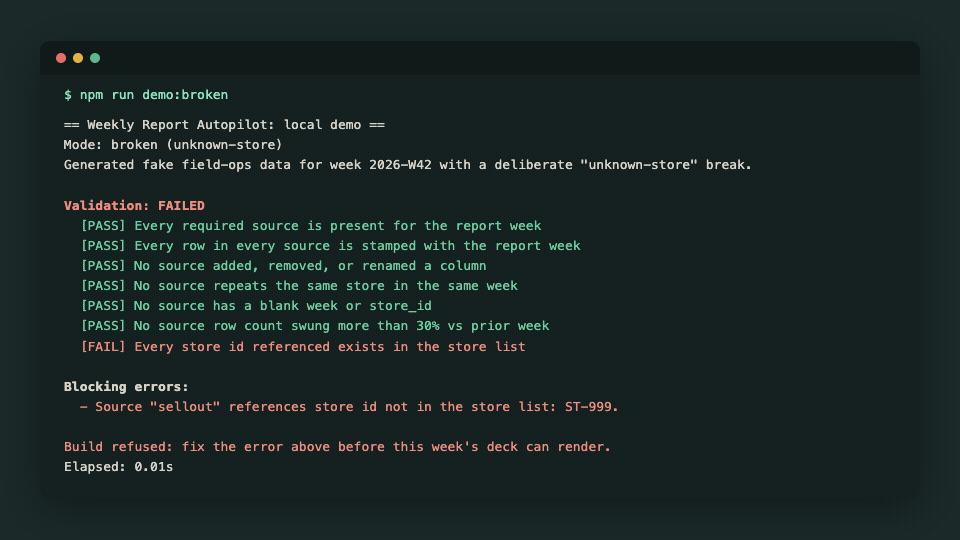
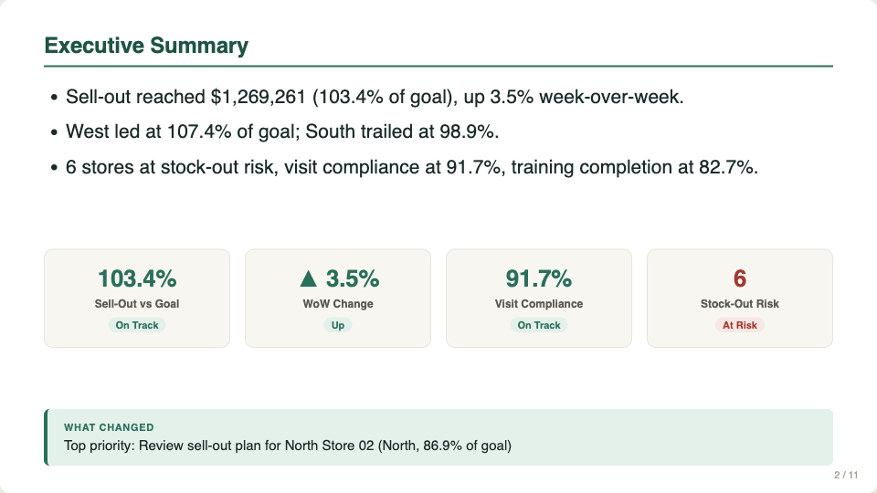
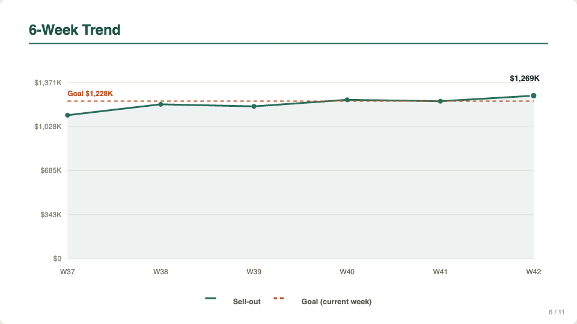
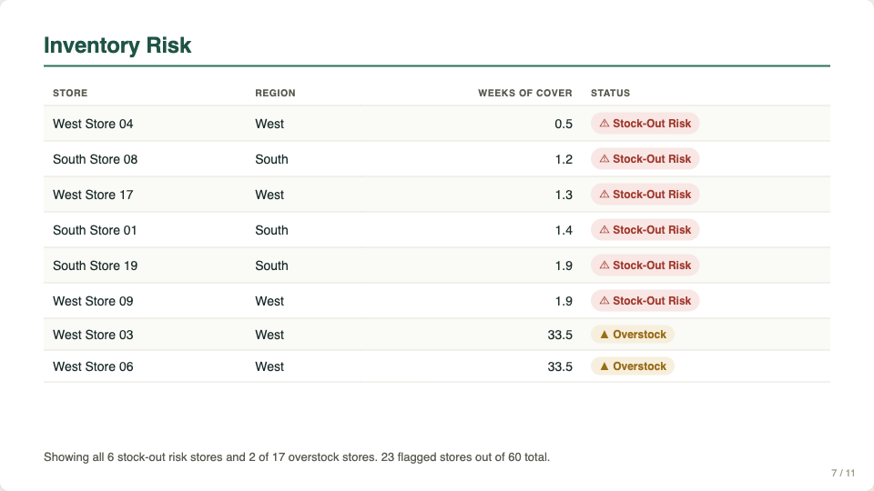
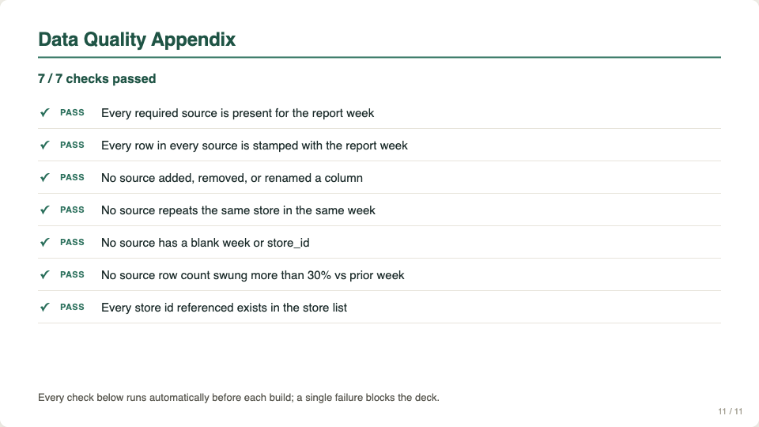

# weekly-report-autopilot

[](https://github.com/nacrissi/weekly-report-autopilot/actions/workflows/test.yml)

**A weekly leadership deck that builds itself from six data sources, and refuses to build when the data is wrong.**

Most weekly decks get built by hand on Monday morning. Someone pulls six exports, pastes them into a sheet, fixes the one that came in with a new column, and copies numbers into slides. It takes hours. And the dangerous week isn't the slow one. It's the week a source arrives broken, nobody notices, and leadership makes calls on a wrong number.

This repo is a working model of the fix: a Sheets menu that validates every source, computes the numbers, and renders an 11-slide deck. If any check fails, it stops and says exactly what's wrong.

All data here is invented and generated from a seed.



## Before and after

| | By hand | With the autopilot |
|---|---|---|
| Building the deck | 3+ hours of exports, pasting and slide edits | One menu click: **Weekly Report > Build deck** |
| A source changes its columns | Found later, if at all | Build refused: schema drift named by source |
| A store that isn't on the list | Quietly counted, or quietly dropped | Build refused, with the store id |
| Rebuilding after a fix | A second deck, and a question about which is current | Same week replaces its own deck |
| "Where did this number come from?" | Ask whoever built it | Click the cell: it's a visible `SUMIFS` over the raw rows |
| Two people click at once | Two half-built decks | A script lock lets one build run at a time |

## What it checks before it builds

```
Validation: FAILED
  [PASS] Every required source is present for the report week
  [PASS] Every row in every source is stamped with the report week
  [PASS] No source added, removed, or renamed a column
  [PASS] No source repeats the same store in the same week
  [PASS] No source has a blank week or store_id
  [PASS] No source row count swung more than 30% vs prior week
  [FAIL] Every store id referenced exists in the store list

Blocking errors:
  - Source "sellout" references store id(s) not in the store list: ST-999.

Build refused: fix the error(s) above before this week's deck can render.
```

That's the real output of `npm run demo:broken`, which plants one unknown store in the sell-out data.

## The deck

Eleven slides: title, executive summary, KPI tiles, sell-out by region, top and bottom stores, a 6-week trend, inventory risk, visit compliance, training completion, actions and owners, and a data-quality appendix that lists every check that ran.

| | |
|---|---|
|  |  |
|  |  |

All 11 slides are in [`docs/img/`](docs/img/). Open [`docs/sample-output/deck.html`](docs/sample-output/deck.html) to page through the full deck.

## How it works

```
six source tabs (sell-out, inventory, store visits, training, staffing, goals)
        │
        ▼
  validate()      ──► any blocking error? stop, show the list, log "blocked"
        │
        ▼
  computeMetrics() ──► KPI model: attainment, week-over-week, risk, compliance
        │
        ▼
  buildDeckSpec()  ──► platform-neutral JSON: 11 slides
        │
        ├─► Apps Script: copy the template deck, fill each slide, log the run
        └─► Local demo: render the same spec to HTML
```

- **`src/core/`** holds all the logic: `validate.js`, `metrics.js` and `deck-spec.js`. Plain functions, no Apps Script calls, no Node calls.
- **`src/apps-script/Code.js`** is the glue inside the Sheet: the menu, the script lock, reading tabs, rendering into Slides, the `Runs` tab and the `AuditLog` tab.
- **`src/demo/render-html.js`** renders the same deck spec as HTML, so you can see the output without signing in anywhere.

## Design decisions

- **Validation is a gate, not a warning.** Seven checks can block a build. Smaller anomalies come back as warnings and still build. A wrong number in front of leadership costs more than a late deck.
- **The logic never touches the platform.** The core takes data in and returns results, so it's tested in Node against the exact code that runs in Apps Script. A test fails if anyone adds an Apps Script or Node call to the core.
- **Formulas, not pasted numbers.** The Summary tab is written as `SUMIFS` formulas over the raw tabs. Anyone reviewing can click a number and see how it was reached.
- **A broken template blocks the build too.** Before touching Drive, the script checks that the Slides template has all 11 tagged slides. If one is missing, it names it and logs the build as blocked, rather than shipping a deck with a gap.
- **One deck per week.** The `Runs` tab records each week's deck. Rebuilding a week trashes the old copy and records the new one, so there's never a question of which deck is current.
- **Status is never color alone.** Every tile and badge carries a text status (On Track, Watch, At Risk) alongside its color.
- **Every visual in this repo is real output.** The refusal screen is the captured text of `npm run demo:broken`. The slides are screenshots of the generated deck.
- **No dependencies.** The seeded data generator, CSV reader and charts are all small, hand-written pieces. Nothing to install, nothing to audit.

## Run it in 2 minutes

Needs Node 20 or newer. No dependencies to install.

```bash
git clone https://github.com/nacrissi/weekly-report-autopilot.git
cd weekly-report-autopilot
npm test              # 65 tests
npm run demo          # generate a week, validate, build out/deck.html
npm run demo:broken   # plant a bad store id and watch the build refuse
```

Then open `out/deck.html` in a browser.

### Running it in a real Sheet

The Apps Script side needs your own Sheet, Slides template and Drive folder. Install clasp (the Apps Script command-line tool), copy `src/apps-script/.clasp.json.example` to `.clasp.json` with your script id, set the template and folder ids at the top of `Code.js`, and `clasp push`. The template marks each slide with `{{slide:<id>}}` in its speaker notes.

## The real story

This is a from-scratch rebuild of one piece of my work on a retail field-sales program. No employer code or data is in this repo.

The weekly leadership report pulled from 6+ sources: BigQuery, Sheets and internal databases. I built an automation that generates the 11-slide deck in under 5 minutes, replacing a 3+ hour manual build. Across that reporting, recurring errors traced back to unguarded handoffs between the sources. A six-layer verification protocol closed them and cut critical reporting errors about 90%. Every automation wrote raw data and left the math as visible in-cell formulas, so a non-technical reviewer could audit any number by clicking the cell.

## License

MIT
